# KioWiki

KioWiki is a self-hosted collaborative wiki built in PHP, HTML, CSS, and vanilla JavaScript. It requires PHP 8.1 or newer and a writable data directory. There is no Composer or npm install, build step, CDN, or framework.

## Screenshots

[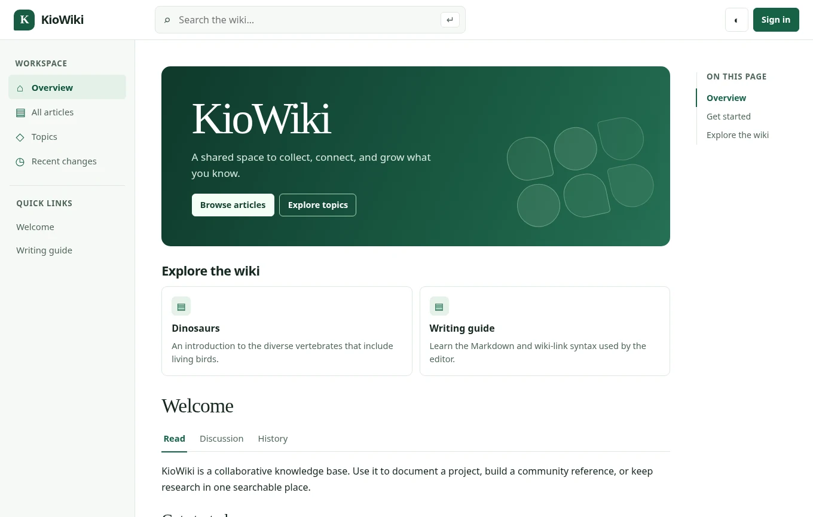](docs/screenshots/overview.webp)

| | |
| --- | --- |
| **Dinosaurs article with a section outline**<br><a href="docs/screenshots/article.webp">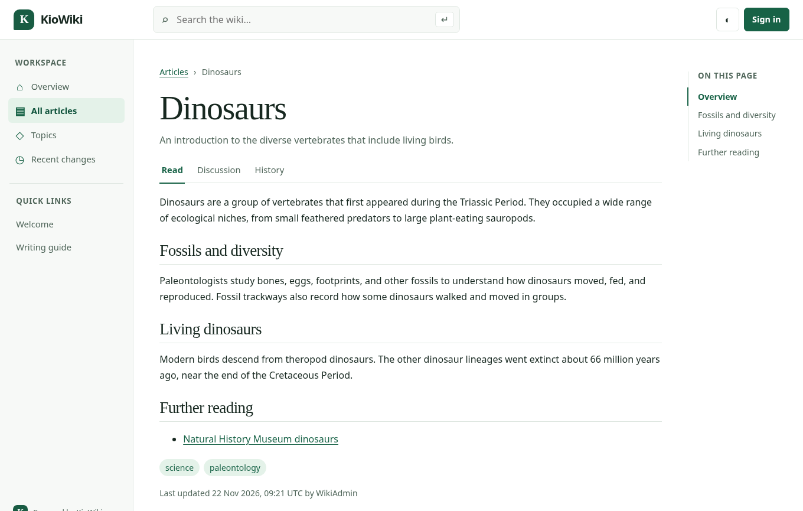</a> | **Article directory**<br><a href="docs/screenshots/article-directory.webp">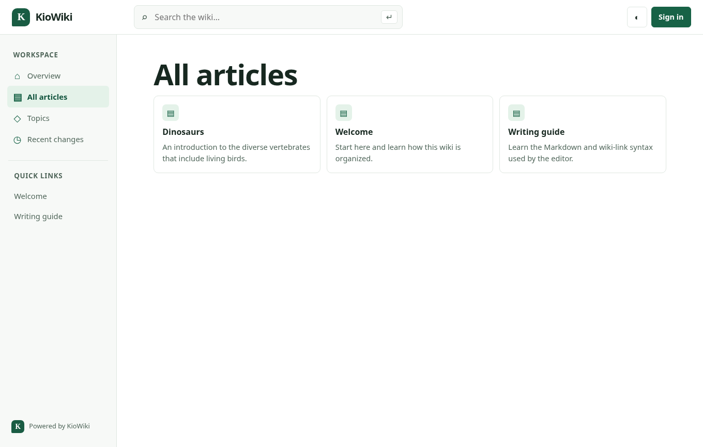</a> |
| **Search results for fossils**<br><a href="docs/screenshots/search-results.webp">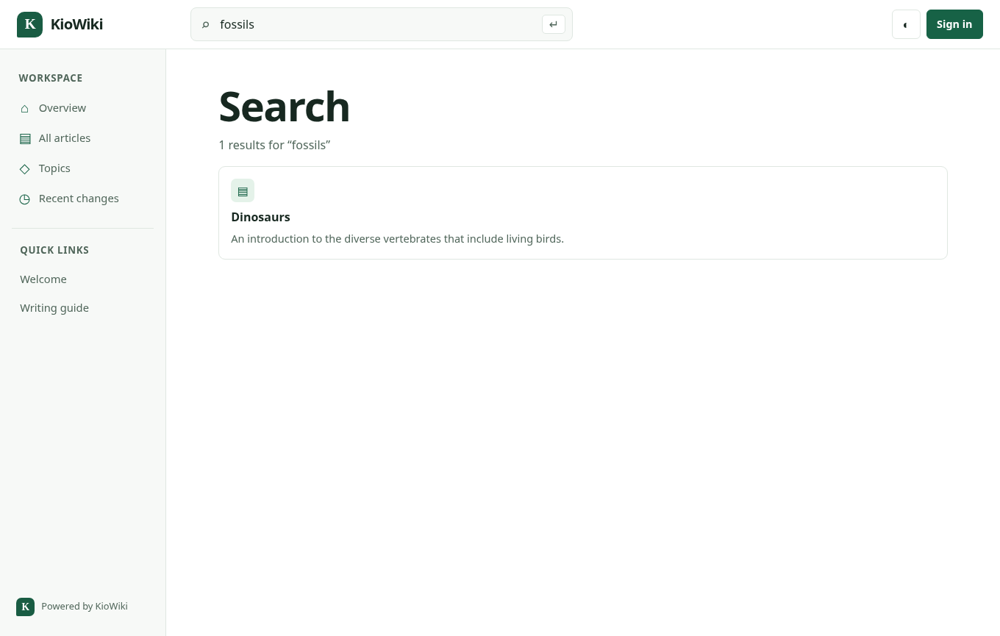</a> | **Topic directory**<br><a href="docs/screenshots/topics.webp">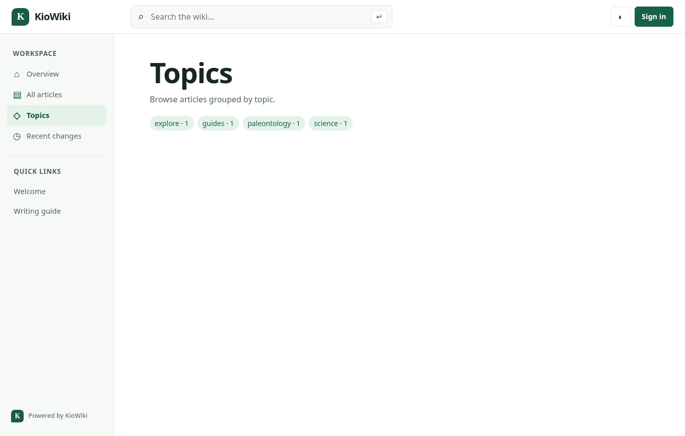</a> |
| **Markdown editor and live preview**<br><a href="docs/screenshots/markdown-editor.webp">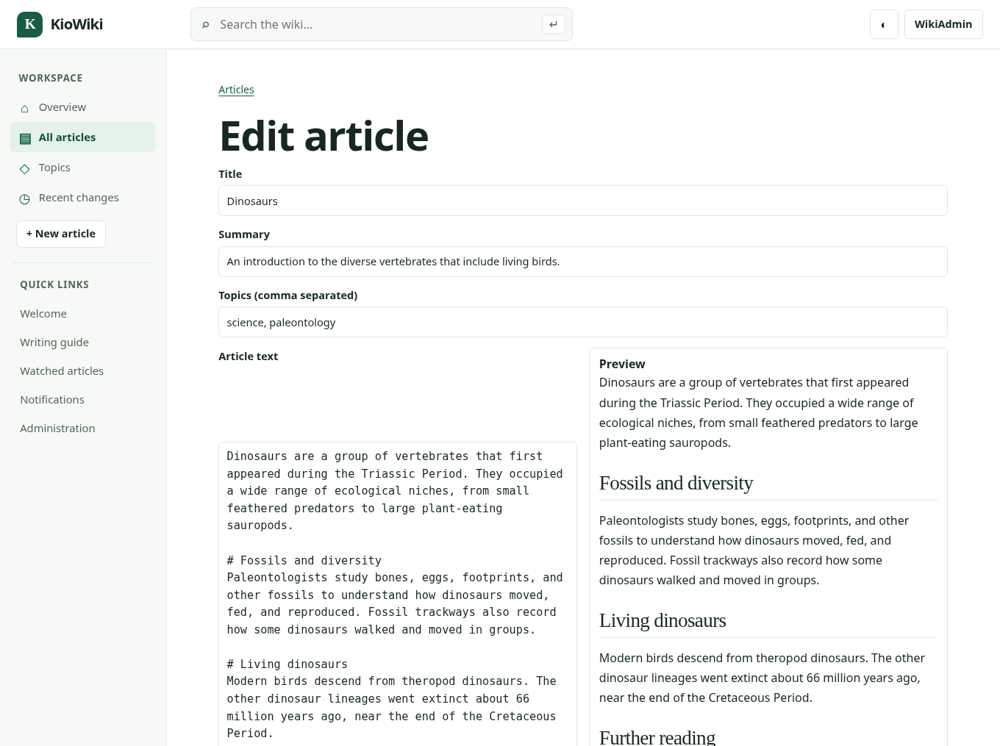</a> | **Article revision history**<br><a href="docs/screenshots/revision-history.webp">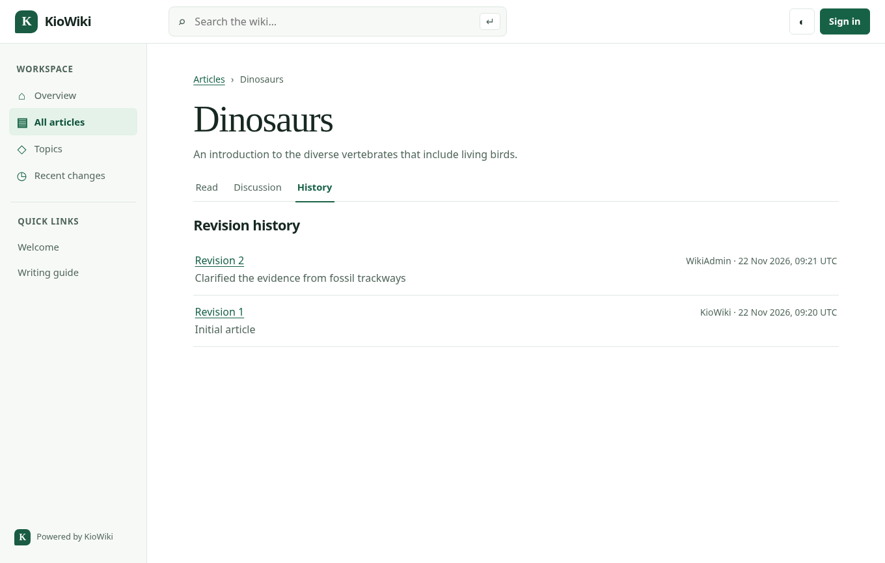</a> |
| **Article discussion**<br><a href="docs/screenshots/discussion.webp">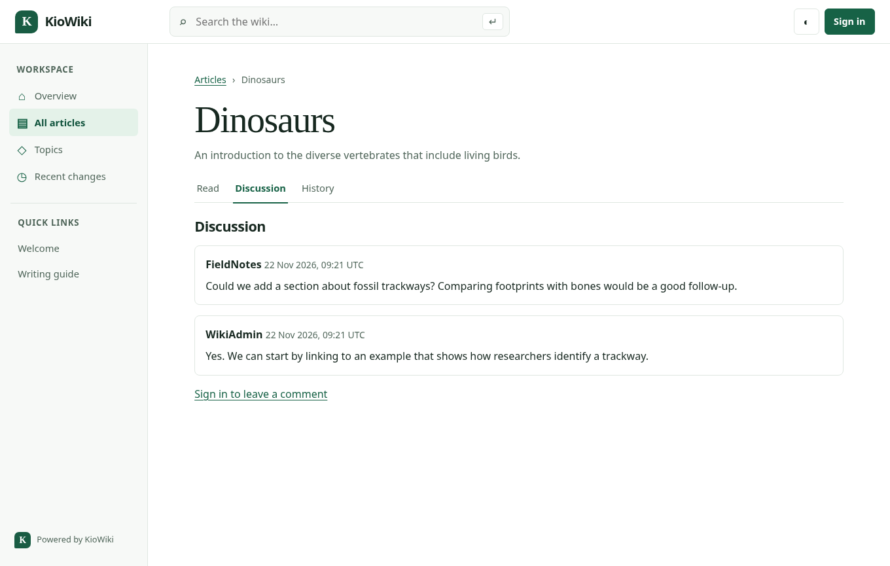</a> | **Recent changes**<br><a href="docs/screenshots/recent-changes.webp">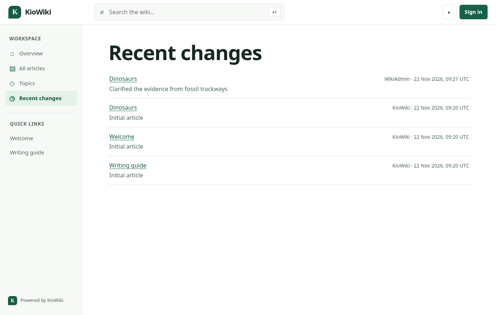</a> |
| **Watched articles**<br><a href="docs/screenshots/watchlist.webp">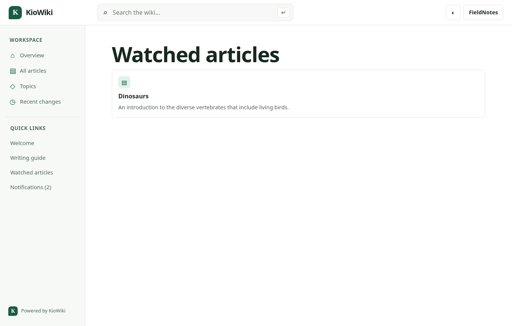</a> | **Watch notifications**<br><a href="docs/screenshots/notifications.webp">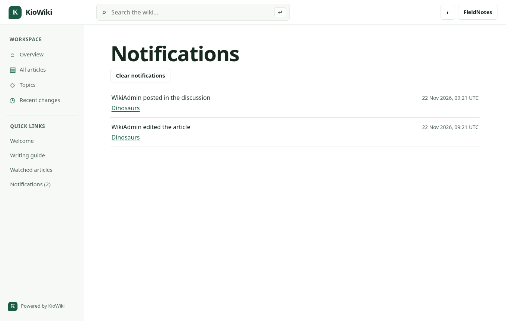</a> |
| **Sign-in form**<br><a href="docs/screenshots/sign-in.webp">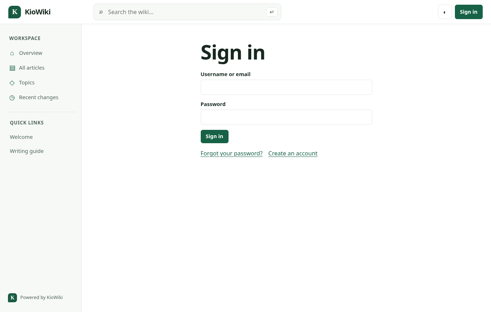</a> | **Signup form**<br><a href="docs/screenshots/sign-up.webp">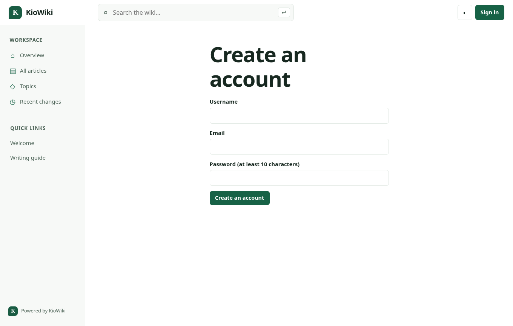</a> |
| **Administration settings**<br><a href="docs/screenshots/administration.webp">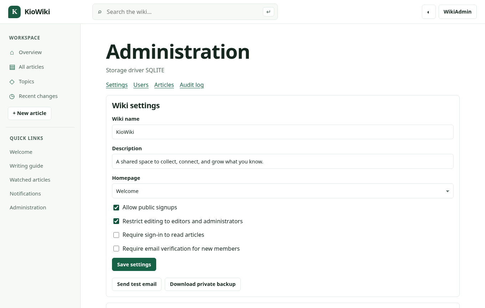</a> | **Mobile article in dark mode**<br><a href="docs/screenshots/mobile-dark.webp">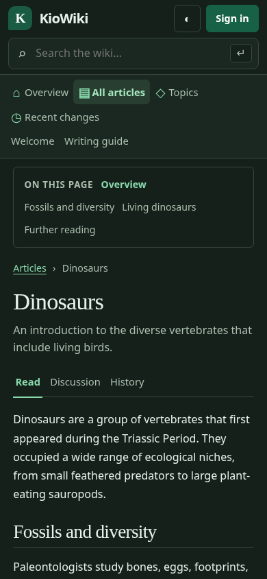</a> |

## Start locally

```sh
php -S 127.0.0.1:8000 router.php
```

Open http://127.0.0.1:8000 and choose **Set up this wiki** to create an administrator. KioWiki automatically creates its database and starter articles on the first request. Article URLs, outlines, topics, history, and search are generated from the stored content. For example, the starter dinosaur article is at `/articles/dinosaurs`.

## Install on a server

1. Copy the project files, including the hidden `.htaccess` files, to the wiki's document root. Omit `.git`. Use Apache 2.4 with PHP and `mod_rewrite`, or use [the NGINX example](deploy/nginx.conf) with PHP-FPM. Change its document root, hostname, and PHP-FPM socket for your server and enable HTTPS.
2. Ensure PHP can create `.kiowiki` in the wiki directory. On a VPS, you can instead create a directory owned by the PHP service user outside the document root and set `data_dir` in `config.php`.
3. Load the site, find `setup.key` in the data directory using SSH or your hosting file manager, and enter its value on **Set up this wiki**. Local loopback requests to the PHP development server skip the key. After setup you can delete it.
4. Confirm requests for `/.kiowiki/setup.key`, `/app/Store.php`, and `/config.php` return 403 or 404 before exposing the site. Keep PHP's `display_errors` off on production.

An [Apache virtual host example](deploy/apache.conf) is provided. On shared hosting, upload to the provider's public PHP directory, often `htdocs` or `public_html`, and leave the supplied `.htaccess` files in place. The Apache rewrite also works when the wiki is installed in a subdirectory. If your host allows private-directory protection but disables URL rewriting, copy `config.example.php` to `config.php`, set `pretty_urls` to `false`, and open `/index.php`. In this mode the wiki produces routes such as `/index.php?r=articles%2Fdinosaurs`. For InfinityFree, verify your plan's PHP version, available drivers, rewrite support, and mail restrictions. Use JSON if SQLite is unavailable, or the MySQL credentials created through the hosting panel.

## Data and mail

Copy [config.example.php](config.example.php) to `config.php` to set overrides. New installations use PDO SQLite if present and JSON otherwise. Existing automatic installations retain their original backend. The driver can also be explicitly set to `sqlite`, `json`, `mysql`, or `mariadb`. For MySQL and MariaDB, create an empty database and a user with permission to create and update the `kiowiki_state` table, then set the PDO connection string and credentials. Custom data files should live outside the document root.

KioWiki uses a single transactional state document with a write lock. This is intended for small, single-site wikis. Memory usage and write time grow with the size of the wiki and its revision history. Administration can export a private JSON backup containing articles, users and password hashes. To restore or migrate that backup, stop writes, put it at a new protected `json_path`, and set the driver to `json` before restarting. Back up the original backend, keep exports private, and leave config files out of Git.

Account email supports SMTP with certificate-validated STARTTLS or implicit TLS, or the host's PHP `mail()` transport. Set `base_url` to the public wiki root, including its subdirectory if applicable. Configure either the `smtp` block or `mail_from` for PHP mail, then send a test from Administration. Password recovery and optional signup verification use expiring, single-use links. The PHP host must permit its configured mail transport. SMTP mode requires OpenSSL and outbound access to the mail service.

## Wiki tools

- Article directory, full-text search, topics, recent changes, Markdown editing and live preview
- Wiki links, external links and images, generated heading navigation, revision history and one-click revision restoration
- Article discussion, watchlists, and in-app updates
- Signup, sign-in, password change, email verification, and password reset
- Public and private modes, member/editor/administrator roles, article locking and archival, audit log, and private export

Markdown covers headings, emphasis, inline and fenced code, block quotes, lists, rules, links, images, and `[[Article title|label]]` links. Raw HTML is displayed as text. Article addresses stay stable when an article's title changes.

## Design references

KioWiki uses an original forest-green visual identity. Its global search and split Markdown preview draw on [Wiki.js Basics](https://docs.js.wiki/guide/basics) and the [Wiki.js Markdown editor](https://docs.js.wiki/guide/editors/markdown). The article outline follows the persistent navigation pattern discussed in [MediaWiki Vector design documentation](https://www.mediawiki.org/wiki/Skin:Vector/2022/Design_documentation).
